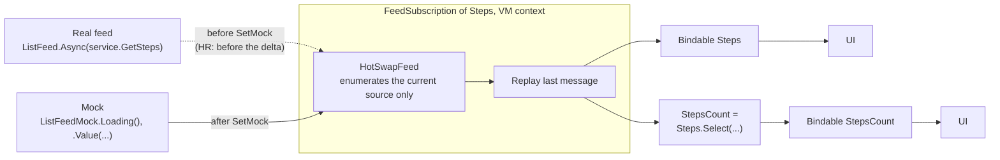
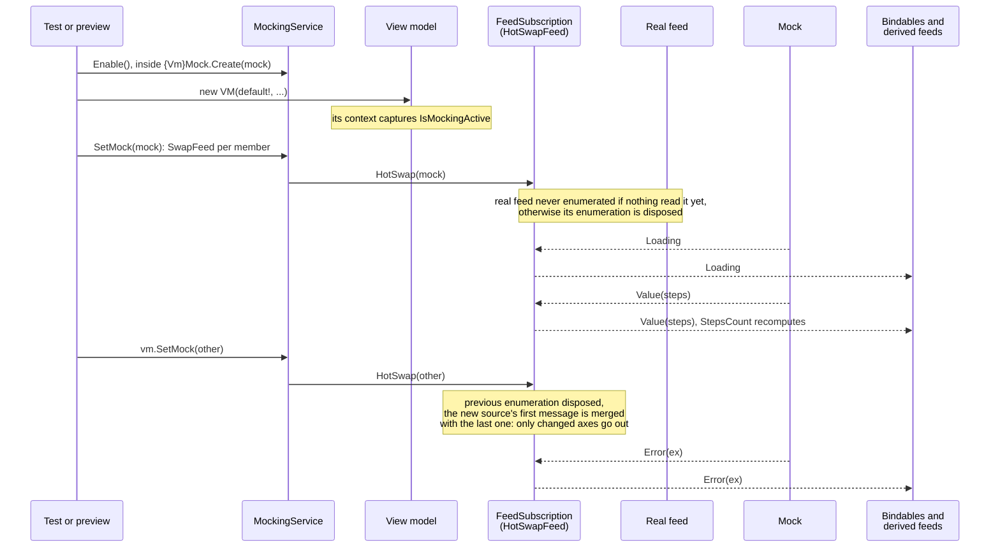
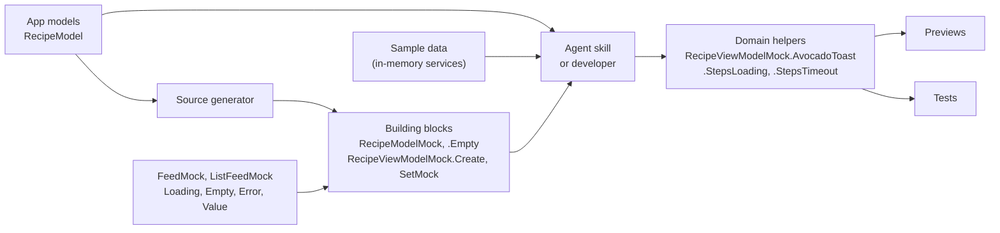
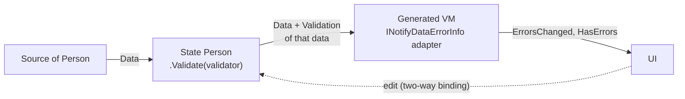
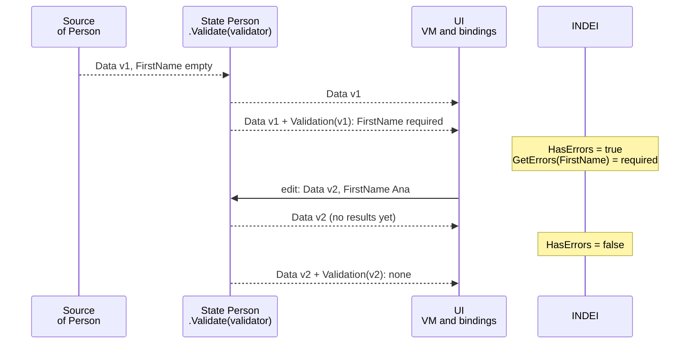
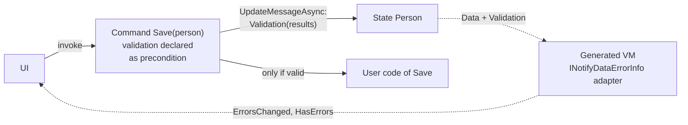
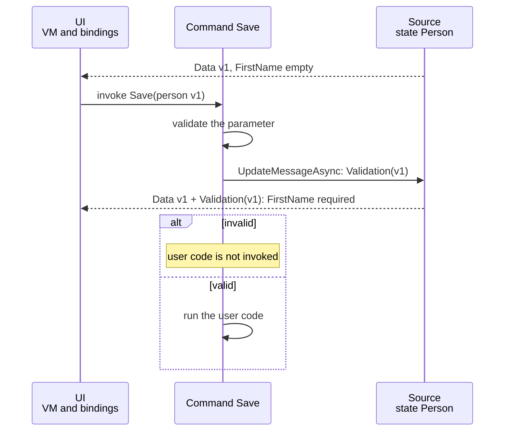

# 018 — MVUX mocking and validation: architecture reference

> State as of 2026-10-16. Repos: `uno.extensions` (code, specs), `uno` (Uno.Sdk packaging),
> `studio.live` (main client: previews). This is the design reference for both features: when the
> implementation diverges, update the diagrams here to say so rather than leaving them stale.
>
> Outline: [TL;DR](#tldr) · [Mocking](#mocking-architecture) ·
> [Building blocks and helpers](#generated-building-blocks-domain-helpers-by-the-agent) · [Validation](#validation-shape) ·
> [Code map](#code-map) · [Known traps](#known-traps) · [Open items](#open-items) ·
> [Next steps](#next-steps)

Two MVUX features. **Mocking** (spec 013) pins any service-dependent feed of a real generated view
model to a chosen state (loading, error, empty, value) from a test or preview project, while derived
feeds keep running the real business logic; the variants worth showing are written as domain helpers on
top of it. **Validation** carries `ValidationResult`s as a metadata axis on a feed's messages. The swap mocking relies on is the
same code path as MVUX hot reload, so a regression there breaks both.

**One principle behind both.** MVUX is a flow of messages through feeds and operators; a message is a
value plus metadata, carried as axes (data, error, progress, and later pagination). Once the flow is
built, nothing edits it: what a feature adds goes **through** the flow, either as a replaced source
(a mock, on the hot reload mechanism) or as one more axis on the message (a validation result). No
feature keeps its own state next to the flow.

## TL;DR

- **Mocking** is merged on `main` and backported to `servicing/7.4`; spec 013 is at v19. Since 10-08,
  three fixes made generated mocks usable for previews: a messenger for mocked view models (#3214),
  state and list-state inputs mocked where the state is read (#3216), and a list with a selection
  (#3247, open). All are tied to [studio.live#4074](https://github.com/unoplatform/studio.live/issues/4074).
- **Packaging**: `Uno.HotTesting.Reactive` is now bundled with MVUX in the Uno.Sdk
  ([uno#25095](https://github.com/unoplatform/uno/pull/25095), merged 10-08), non-optimized builds only.
  The `servicing/6.8` backport for Studio 3.3 is [uno#25407](https://github.com/unoplatform/uno/pull/25407)
  (open, review required).
- **Split of work**: the generator produces typed building blocks; the domain helpers (plausible data,
  named variants such as `StepsLoading`) are expected from an LLM skill or a developer. Studio previews
  are the main client, owned by the Studio team.
- **Validation**: a metadata axis on a feed's messages, filled live by the state (`.Validate(...)`,
  see the note in [Validation shape](#validation-shape)) or by a command on invoke. Architecture proposed here, implemented by other team members (#3203,
  #3204, #3222, in review).

## Mocking architecture

**Message flow.** Arrows follow the messages, from the source to the consumers. Each feed of a view
model has one `FeedSubscription` per context, which enumerates its source once and replays the last
message to every consumer, bindables and derived feeds alike. Under mocking or MVUX hot reload, that
subscription enumerates a `HotSwapFeed` instead of the feed itself: whatever source is plugged in, the
consumers keep the same subscription.



**Over time.** Plain arrows are calls, dotted arrows are messages. `{Vm}Mock.Create(mock)` builds the
view model inside a `MockingService.Enable()` scope and applies the mock at once; `SetMock` can be called
again later, outside the scope, because each context captured its mockability when it was created.



- **One swap point, in the subscription.** `FeedSubscription` predates `HotSwapFeed`, which was first
  wired into `StateImpl` only. Operators (`Select`, `Where`, `Combine`, dynamic feeds) read the
  subscription, so a mocked state left derived members running over the null-injected real input. #3192
  keeps a single mechanism in `FeedSubscription`, shared by hot reload and mocking. State and subscription
  caches stay separate, so a local state edit does not leak to operators. Details:
  [history.md v16 to v19](../013-mvux-mocking-previews/history.md).
- **State inputs (v19, #3216).** For a state input, what is swapped is the feed its `UpdateFeed` reads,
  at the context's subscription to it: the real loader never runs, and the state keeps its own updates
  over the mock. Each `SetMock` clears them, so the state restarts from its mock. A first version of the
  PR added a second, mocking-only swap point; it was rejected in review because it reopened the two
  mechanisms #3192 had merged.
- **Recursion guard.** `HotSwapFeed` enumerates its feed directly (`Feed?.GetSource(context, ct)`), never
  through `context.GetOrCreateSource(feed)`, which returns the same subscription and would subscribe it
  to itself. A mock that is the member's own feed restores the real one. Guarded by
  `When_HotSwapEnabled_Then_SourceIsEnumeratedDirectly` in
  [Given_FeedSubscription.cs](../../src/Uno.Extensions.Reactive.Tests/Core/Given_FeedSubscription.cs).
- **Fail-hard (D11).** `SetMock` on a model built outside a `MockingService.Enable()` scope throws
  `InvalidOperationException`. Hot reload is best-effort; mocking is strict.
- **No silent bail-out.** A reachable model whose view model has no public constructor reports
  `MOCK0001` instead of emitting nothing, so a skipped model, a picked-up opt-out and a generator failure
  are distinguishable. Same rule: `MOCK0002` (model with no mockable input, Info) and `MOCK0003`
  (invalid implicit-model regex).
- **Constructor parameters.** `{Vm}Mock.Create` passes `default!` for every constructor parameter, except
  a fresh `WeakReferenceMessenger` for the messenger (#3214), recorded in spec 013 v18 as a stopgap.
- **Link with Hot Testing.** `Uno.HotTesting.Reactive` holds the spec 009 vocabulary (`FeedMock`,
  `ListFeedMock`) and the spec 013 generator. It is the MVUX piece of Hot Testing.

## Generated building blocks, domain helpers by the agent

The generator only produces **typed building blocks**, from the app's own models, in the test or preview
project. What gives a mock its meaning, the domain data and the named variants, is **not generated**: it
is expected from an LLM (an agent skill) or a developer, as readable helpers on top of those blocks.



| Generated (building blocks) | Written by the agent (domain helpers) |
|---|---|
| `{Model}Mock`: one `required` member per service-dependent input, so the compiler lists what to fill | Plausible data for the domain, reused from the sample data the app already has |
| `{Model}Mock.Empty`, `{Vm}Mock.Create(...)`, `SetMock(...)` | Named variants: one readable entry per case worth showing (normal, loading, empty, error) |
| `FeedMock` / `ListFeedMock` states, from `Uno.HotTesting.Reactive` | Kept in a `partial` of the generated `{Vm}Mock`, in the test or preview project |

```csharp
// Generated: the building blocks
var vm = RecipeViewModelMock.Create(new RecipeModelMock { Steps = ListFeedMock.Value(steps) });

// Written by the agent: domain helpers, named for what they show
public static partial class RecipeViewModelMock
{
    public static RecipeViewModel AvocadoToast => Create(new RecipeModelMock { Steps = ListFeedMock.Value(Samples.AvocadoToastSteps) });
    public static RecipeViewModel StepsLoading => Create(RecipeModelMock.Empty with { Steps = ListFeedMock.Loading<Step>() });
    public static RecipeViewModel StepsTimeout => Create(RecipeModelMock.Empty with { Steps = ListFeedMock.Error<Step>(new TimeoutException()) });
}
```

- **An LLM for now.** The domain helpers are written by an agent skill today; a dedicated generator may
  come later, but the skill is already good enough. Tests and previews are the two consumers.
- **Variations are helpers, not a mechanism.** Each named entry is one variant; a preview or a test binds
  to it (`DataContext="{x:Bind mocks:RecipeViewModelMock.StepsLoading}"`), and `SetMock` can walk states live.
- **The compiler keeps the helpers honest.** An entry built with `new {Model}Mock { ... }` stops compiling
  when the model gains a service-dependent input, which tells the agent what to update.
- **Main client: Studio previews**, owned by the Studio and Hot Design teams and out of this handover. The
  contract with them is the API above. Their current plan, studio.live spec
  [085-preview-mocks](https://github.com/unoplatform/studio.live/blob/main/specs/085-preview-mocks/spec.md)
  for [#4074](https://github.com/unoplatform/studio.live/issues/4074), builds previews over the in-memory
  services rather than over these mocks; the packaging blocker it cites is lifted by uno#25095. The mocking
  fixes since 10-08 come from that work.

## Validation shape

> This is the architecture proposed by the author of this document. Its implementation is carried by
> other members of the team ([#3203](https://github.com/unoplatform/uno.extensions/pull/3203),
> [#3204](https://github.com/unoplatform/uno.extensions/pull/3204),
> [#3222](https://github.com/unoplatform/uno.extensions/pull/3222)).

Validation is a **metadata axis** packed in the messages of a **feed**, next to the data, like progress
or error. It is filled in two scenarios:

- **Live**: ~~the fluent operator **`.Validation(...)`** on a feed adds the validation to each data it
  forwards~~. Implemented on the **state** instead (**`.Validate(...)`**, see the note below): the state
  validates each of its data, including the edits from the view.
- **On demand**: a **command**, when it is invoked, validates its parameter as a precondition declared
  with the command, sets the result by hand on the **state** the parameter comes from, then runs the
  user code only if the result is valid.

The result is tied to the **id of the data it validated**, rather than tracked through operators: a
consumer shows it only while it still displays that data.

A validation is therefore a **projection**: an input, a value, one more axis on the output. The feed
stays stateless: no validation loop, no validator stored in a state. An asynchronous validator needs
nothing more than the existing progress axis while it runs.

> **Implementation diverges for live validation (spec 022, [#3203](https://github.com/unoplatform/uno.extensions/pull/3203)).**
> Live validation is held by the **state**, `State.Value(...).Validate(validator)`, not by a feed
> operator. The values worth validating live are the ones the user edits, and those edits are applied
> by the state itself, downstream of its source: an operator on the source never sees them, and an
> operator after the state would hand the view a feed it cannot write to. So the state runs the
> validator after each change of its data (including the edits from the view), off the UI thread, and
> keeps the last results as one update of its own messages.
>
> The principle above still holds where it matters: the results are an axis of the message, local to
> the state (never forwarded to `Select`, `Combine`...), and tied to the data they validated. The state
> checks them against its current data each time its message is rebuilt or its data is updated, so they
> are never shown for another value, and they survive the source producing the same value again (a
> refresh), which a projection would recompute. The command keeps the on-demand role described below,
> and publishes through the same entry point of the state.

### Live validation

Arrows follow the messages. As implemented (spec 022): the state holds the validator, and the edits
from the view go through the state too.



Over time: the state validates each data, then adds the results to its message. Until they arrive
(the validator runs off the UI thread), the new data has no results: the ones of the previous data are
never shown for it. The INDEI column shows only what the adapter exposes after each message.



### On-demand validation

Plain arrows are calls, dotted arrows are messages.





`INotifyDataErrorInfo` is only the **binding adapter** the generated view model implements; the contract
is the axis. Its `HasErrors` and `ErrorsChanged` are about validation only: they are unrelated to the
MVUX **error** axis, which stays the exception channel. There is no new interface in `Uno.Extensions.Validation`: the adapter bridges INDEI and the
existing `IValidator`.

| Date | Decision |
|---|---|
| 09-17 | No trigger and no "on save" mode: save-time validation belongs to the command. INDEI is the binding adapter, not the contract |
| 09-29 | Validation is its own message axis; the result is tied to the id of the validated data, not tracked through operators |
| 10-06 | Two producers: the fluent `.Validation(...)` operator, and the command on invoke, whose first step validates before any user code |
| 10-16 | This document is the reference: if the implementation diverges, the diagrams are updated to say so, rather than left stale |
| 10-29 | Live validation is held by the state (`Validate`), not a feed operator: edits from the view are applied by the state, downstream of any operator on its source (spec 022) |

## Code map

| Path | Role |
|---|---|
| [Core/Internal/FeedSubscription.cs](../../src/Uno.Extensions.Reactive/Core/Internal/FeedSubscription.cs) | Wrap gate and `HotSwap`, shared by HR and mocking |
| [Operators/HotSwapFeed.cs](../../src/Uno.Extensions.Reactive/Operators/HotSwapFeed.cs) | Swappable source, direct enumeration |
| [Core/Internal/SourceContext.cs](../../src/Uno.Extensions.Reactive/Core/Internal/SourceContext.cs) | `IsMockingActive`, `IsMockingActiveProbe` |
| [Uno.HotTesting.Reactive/MockingService.cs](../../src/Uno.HotTesting.Reactive/MockingService.cs) | Scope (`AsyncLocal`), fail-hard swaps, `SwapStateSource` (v19) |
| [Uno.HotTesting.Reactive.Generator/FeedsMockGenerator.cs](../../src/Uno.HotTesting.Reactive.Generator/FeedsMockGenerator.cs) | `{Model}Mock`, `{Vm}Mock.Create/SetMock`, `MOCK000x` |
| [Core.Generators/Common/FeedDependencyAnalysis.cs](../../src/Uno.Extensions.Core.Generators/Common/FeedDependencyAnalysis.cs) | Feed classification shared by both generators (D13) |
| [spec 022](../022-mvux-validation-indei/spec.md) | Validation: the axis, `State.Validate` and the INDEI adapter of the generated bindables |
| [studio.live specs/085-preview-mocks](https://github.com/unoplatform/studio.live/tree/main/specs/085-preview-mocks) | Previews after the data-model upgrade: spec, architecture, progress |

## Known traps

- **A swappable feed never completes.** A feed normally completes once it has published its last
  message, which releases its resources (`Feed.Async` returning one value, for instance). Wrapped in a
  `HotSwapFeed`, it waits for the next source instead and never completes. Invisible in the UI, but a
  test that enumerates a feed to its end, or code that expects completion, behaves differently with
  mocking or MVUX hot reload enabled.
- **HR cost moved**: since #3192, with MVUX hot reload enabled every `FeedSubscription` is wrapped, not
  only states. MVUX hot reload fixes keep landing in the same code (#3230 derived feeds, #3235 Android).
- **Not for published apps**: hot reload and mocking rely on reflection, so the path is non-AOT (D7),
  debug only, and adds an indirection per feed. The
  Uno.Sdk references the package only in non-optimized builds, `PrivateAssets="all"`, opt-out
  `UnoDisableHotTesting`, version floor 7.4.
- **Mocked inputs still construct the real model**: constructor parameters are `default!` (messenger
  excepted). A model that uses a service in its constructor, rather than in a feed, still throws.
- **Stale header**: `spec.md` of 013 still says "Draft"; [history.md](../013-mvux-mocking-previews/history.md)
  is the current record.

## Open items

| Item | State on 2026-10-16 | Next step |
|---|---|---|
| [#3247](https://github.com/unoplatform/uno.extensions/pull/3247) mock a list with a selection | Draft | Review and merge, then backport to `servicing/7.4` |
| [uno#25407](https://github.com/unoplatform/uno/pull/25407) Uno.Sdk bundling, 6.8 backport | Open, mergeable, review required | Review and merge for Studio 3.3 |
| Skill that writes the domain helpers | Split asked at the 10-05 lead sync: a skills plugin in the Studio repo, mock generation in Hot Design; status unknown | Confirm the owner and where the skill lives |
| Validation: [#3203](https://github.com/unoplatform/uno.extensions/pull/3203) (spec 022), [#3204](https://github.com/unoplatform/uno.extensions/pull/3204) (localization, spec 023), [#3222](https://github.com/unoplatform/uno.extensions/pull/3222) (commands, spec 024) | Draft, carried by other team members | Their owners. Raised at the handoff: check that a child's errors (`FirstName`) reach its parent (`Person`) and the view model |
| [uno.extensions#2062](https://github.com/unoplatform/uno.extensions/pull/2062) MVUX overview doc | Approved in 2023, never merged, untouched since 2024-09 | Rebase and merge, or close |

## Next steps

1. Merge #3247 and uno#25407 so Studio 3.3 gets working generated mocks.
2. Confirm who writes the skill for the domain helpers.
3. Decide #2062.

## Read first

1. [spec 013](../013-mvux-mocking-previews/spec.md): tiers, goals, decisions D1 to D13; then [history.md](../013-mvux-mocking-previews/history.md) v16 to v19.
2. [studio.live spec 085-preview-mocks](https://github.com/unoplatform/studio.live/blob/main/specs/085-preview-mocks/spec.md): the main client's problem, for context.
3. [doc/Reference/Reactive/testing.md](../../doc/Reference/Reactive/testing.md): user-facing mocking API.
